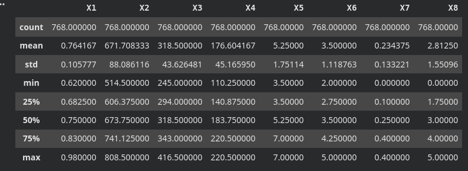
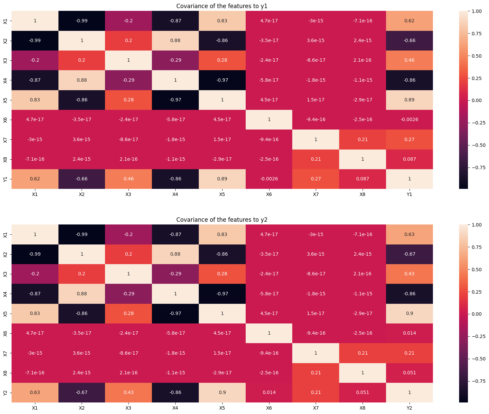
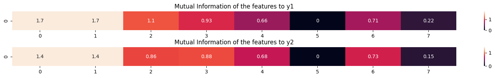
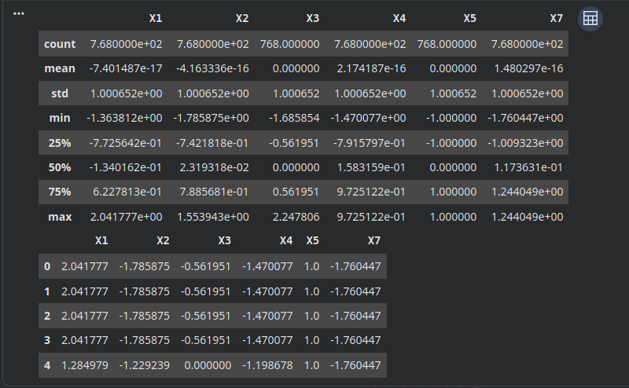
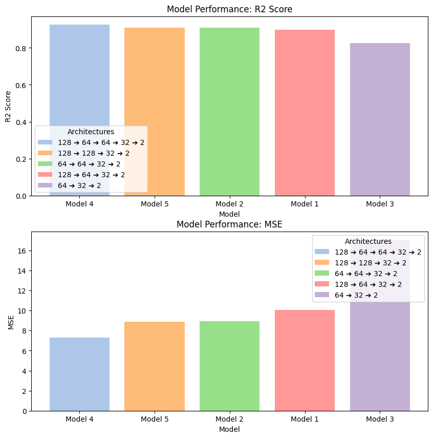

# Building Energy Efficiency Prediction using Deep Learning

This repository contains a comparative study of various Multi-Layer Perceptron (MLP) architectures designed to predict building **Heating Load (Y₁)** and **Cooling Load (Y₂)** simultaneously. The project focuses on data preprocessing, feature importance via Mutual Information, and structural optimization of deep neural networks.

## 📊 Dataset Overview
The dataset contains 8 structural and geometric features of buildings used to determine overall energy requirements:
*   **X₁** Relative Compactness | **X₂** Surface Area | **X₃** Wall Area | **X₄** Roof Area
*   **X₅** Overall Height | **X₆** Orientation | **X₇** Glazing Area | **X₈** Glazing Area Distribution
*   **Targets:** Y₁ (Heating Load), Y₂ (Cooling Load)

---

## 🛠️ Pipeline Details & Visualizations

### 1. Data Analysis & Covariance
Before preprocessing, we evaluated the joint linear variability of our metrics. Notice how physical features like Surface Area, Wall Area, and Roof Area share deep geometric dependencies.




### 2. Feature Importance via Mutual Information
To capture non-linear relationships, we calculated Mutual Information scores. Features like X₆ (Orientation) and X₈ (Glazing Area Distribution) were explicitly marked as discrete to protect the entropy math from estimation errors.



### 3. Scaling & Modeling
Applied `StandardScaler` to align features with vastly different physical units before passing them to our multi-output deep neural networks. Models were trained with a custom vectorized R² tracking metric.

---

## 📈 Model Architecture Evaluation

We benchmarked 5 distinct MLP configurations to isolate the sweet spot between structural depth, capacity, and generalization error:

| Model | Hidden Layer Structure | R² Score | MSE | Status |
| :--- | :--- | :---: | :---: | :---: |
| 🏆 **Model 4** | **128 ➔ 64 ➔ 64 ➔ 32 ➔ 2** | **0.924967** | **7.321872** | **Best Performer** |
| 🥈 **Model 5** | 128 ➔ 128 ➔ 32 ➔ 2 | 0.908897 | 8.898159 | Suboptimal Width |
| 🥉 **Model 2** | 64 ➔ 64 ➔ 32 ➔ 2 | 0.908364 | 8.941851 | Capacity Limited |
| 🏅 **Model 1** | 128 ➔ 64 ➔ 32 ➔ 2 | 0.897067 | 10.065363 | Early Bottleneck |
| ❌ **Model 3** | 64 ➔ 32 ➔ 2 | 0.825213 | 17.055216 | Underfitting |

### 📊 Model Evaluation



### 🚀 Conclusion
Architectural optimization demonstrated that increasing model depth was crucial for this problem; the 4-layer architecture (**Model 4**) achieved the highest overall predictive accuracy, explaining **92.50%** of the total variance with the lowest error rate (**MSE = 7.32**). Restricting the network's capacity or reducing its depth significantly degraded performance, proving that the complex, non-linear thermodynamic relationships governing these energy loads require a deeper hierarchical network layout to generalize effectively.

---

## 💻 Development Environment: Google Colab

This project was developed and optimized entirely within **Google Colab**, utilizing its hosted runtime environments to streamline experimental iterations.

* **Zero Configuration:** Eliminated local environment version mismatches across TensorFlow, Keras, and Scikit-Learn.
* **Accelerated Training:** Leveraged cloud-hosted runtimes to train and evaluate all 5 network configurations rapidly.
* **Seamless Visualization:** Rendered inline interactive Seaborn heatmaps and dual-axis pastel Matplotlib evaluation plots directly inside the notebook environment.

### How to Run in Colab:
1. Upload the project notebook (`.ipynb`) to your Google Drive.
2. Open the file with **Google Colaboratory**.
3. Upload your raw energy dataset directly into the temporary session storage or mount your Google Drive:
   ```python
   from google.colab import drive
   drive.mount('/content/drive')
